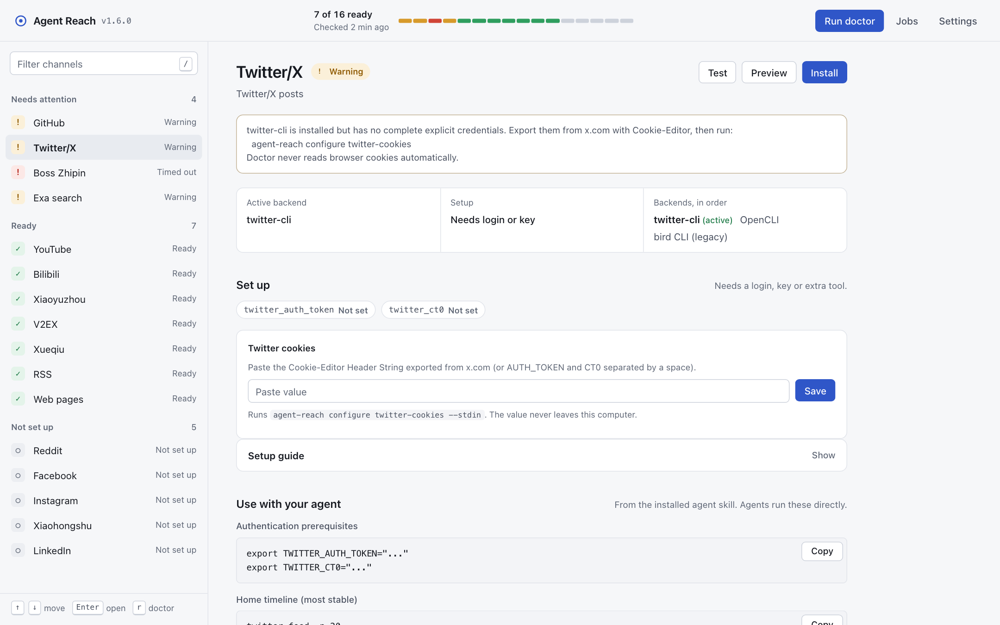
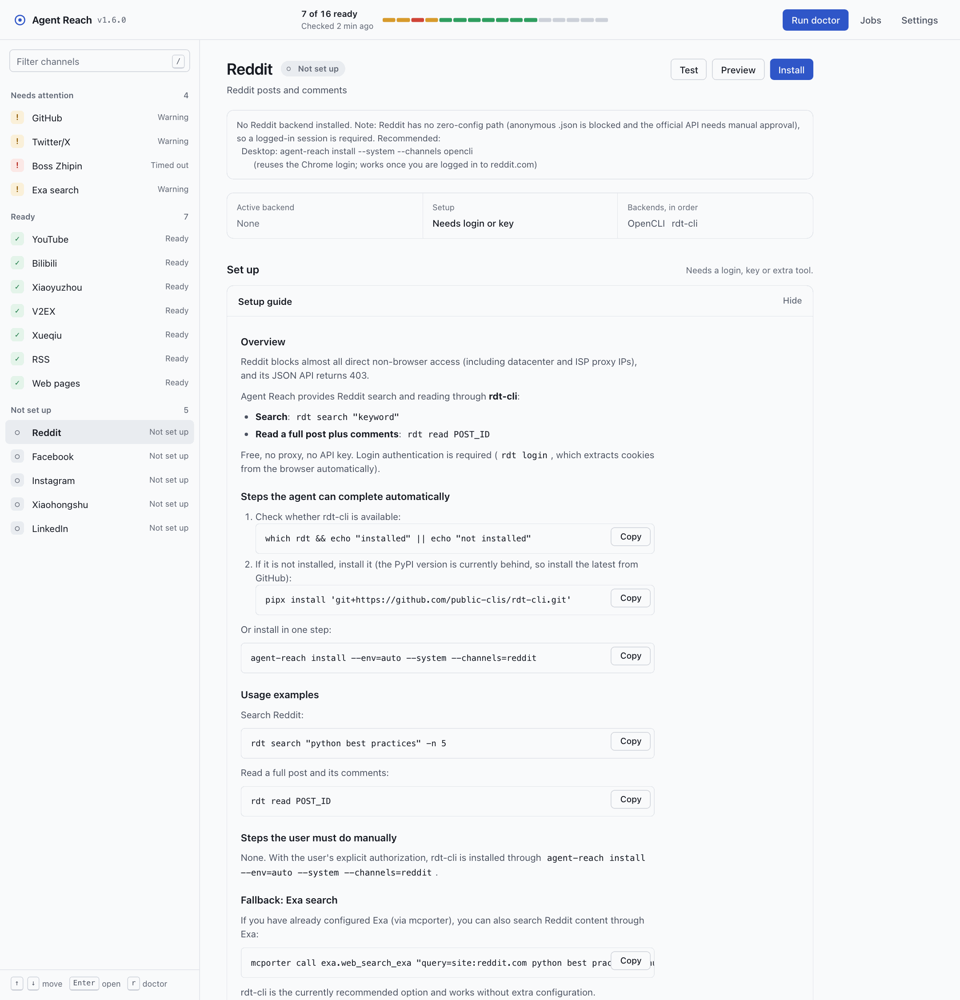
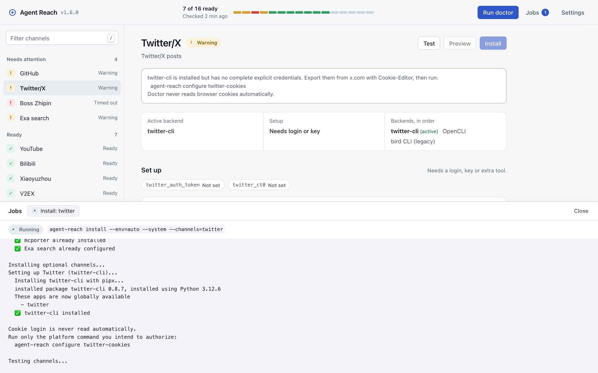
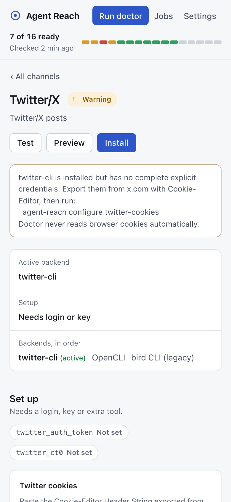
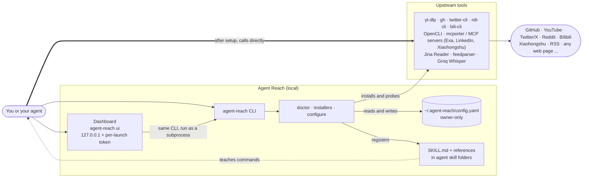

<h1 align="center">👁️ Agent Reach</h1>

<p align="center">
  <strong>Give your AI Agent one-click access to the entire internet</strong>
</p>

<p align="center">
  The most reliable access path for each platform, chosen, installed, and health-checked for you. Backends come and go; you won't notice.
</p>

<p align="center">
  <a href="LICENSE"></a>
  <a href="https://www.python.org/"></a>
  <a href="https://github.com/hemal08ce094/agent-reach/stargazers"></a>
</p>

<p align="center">
  <a href="#quick-start">Quick Start</a> · <a href="#dashboard">Dashboard</a> · <a href="#how-it-works">How it works</a> · <a href="#supported-platforms">Platforms</a> · <a href="#security">Security</a>
</p>

> English fork of [Panniantong/Agent-Reach](https://github.com/Panniantong/Agent-Reach) (MIT), with translation, bug fixes and optimisations.

> **No token or crypto affiliation:** Agent Reach has no official token, coin, investment product, fee-claim program, wallet connection, or Solana/Pump.fun project. Any crypto project using the Agent Reach name, GitHub URL, or author identity is not affiliated with this repository. Do not connect a wallet or claim fees based on messages, posts, or links that say otherwise.

---

## Dashboard

Prefer a window to a terminal? `agent-reach ui` opens a local dashboard that shows the health of every channel, walks you through setup, runs installers with live output, and gives you copy-ready commands for your agent.

<picture>
  <source media="(prefers-color-scheme: dark)" srcset="docs/assets/screenshots/dashboard-dark.png">
  <source media="(prefers-color-scheme: light)" srcset="docs/assets/screenshots/dashboard-light.png">
  
</picture>

<table>
  <tr>
    <td width="40%"></td>
    <td width="40%"></td>
    <td width="20%"></td>
  </tr>
  <tr>
    <td>Setup guides and config keys (shown as set or not set, never the value)</td>
    <td>Allowlisted installs with live output</td>
    <td>Works on small screens</td>
  </tr>
</table>

*Screenshots use demo data.*

```bash
agent-reach ui                 # opens http://127.0.0.1:<random port>/#token=...
agent-reach ui --no-open       # just print the link (e.g. over SSH with port forwarding)
agent-reach ui --port 8765     # pick a fixed port
```

| Key | Action |
|-----|--------|
| `↑` / `↓` (or `j` / `k`) | Move through channels |
| `Enter` | Open the selected channel |
| `/` | Filter channels |
| `r` | Run doctor again |
| `Esc` | Clear the filter, close the jobs panel |

Security model:

- **Loopback only, one link per launch.** The server binds to `127.0.0.1` (remote hosts are refused) and every API call needs a random token that only lives in the printed link's `#fragment`, so it never reaches logs. Host and Origin headers are checked to block DNS rebinding and other sites.
- **No free-form commands.** Buttons map to a fixed allowlist (`install --channels=<known channel>`, `skill --install/--uninstall`, `check-update`, `configure --from-browser` for Bilibili/Xueqiu) that runs the real `agent-reach` CLI as a subprocess, one job at a time, with no shell.
- **Secrets stay put.** Keys and cookies are shown only as set / not set. Values you paste go to `agent-reach configure <key> --stdin`, never into process arguments or logs.

---

## How it works

Agent Reach is a glue layer, not a wrapper. It picks, installs, configures and health-checks the best upstream tool for each platform, then gets out of the way: your agent calls those tools directly, guided by the `SKILL.md` that Agent Reach registers.



The lifecycle:

1. **Install.** `agent-reach install --env=auto` only checks the environment. With `--system` (and optionally `--channels=twitter,reddit,...`) it installs the backends: gh and Node.js through your package manager, mcporter plus the Exa MCP server, and per-channel tools such as twitter-cli, rdt-cli, bili-cli or OpenCLI.
2. **Doctor.** `agent-reach doctor` (or `--json`) probes every channel concurrently under a 30 s budget and reports ok / warn / off / error / timeout plus the `active_backend` that would serve it. Probes are read-only: they never import browser cookies or run commands that write remote state (for example, doctor never runs `gh auth status`).
3. **Configure.** `agent-reach configure <key>` saves tokens and Cookie-Editor exports to `~/.agent-reach/config.yaml` (mode 600) through a hidden prompt or `--stdin`; `--from-browser` imports Bilibili or Xueqiu cookies only when you ask.
4. **Skill registration.** `install --system` or `agent-reach skill --install` copies `SKILL.md` and its references into `~/.agents/skills`, `~/.claude/skills`, `~/.openclaw/skills` and `~/.config/opencode/skills`.
5. **Agent use.** The agent reads the skill, checks `doctor --json` for the active backend, and runs the upstream command itself (`yt-dlp ...`, `twitter search ...`, `mcporter call exa.web_search_exa ...`). Agent Reach is not in that call path.
6. **Stay healthy.** `agent-reach watch` (a quick health and update check for scheduled tasks) and `agent-reach check-update` tell you when a channel breaks or a new release ships; the dashboard shows the same doctor data with a Run doctor button.

---

## Why Agent Reach?

AI Agents can already write code, edit documents, and manage projects. But ask one to go find something on the internet and it gets stuck:

- 📺 "What does this YouTube tutorial cover?" → **Can't read it**, no access to subtitles
- 🐦 "Search Twitter for what people think of this product" → **Can't search**, the Twitter API is paid
- 📖 "Has anyone on Reddit hit the same bug?" → **403 blocked**, server IPs are rejected
- 📕 "What's the word on Xiaohongshu (RedNote) about this product?" → **Won't open**, login required
- 📺 "Summarise this technical video on Bilibili" → **Can't fetch it**, generic downloaders are blocked by Bilibili's risk control
- 🔍 "Search the web for the latest LLM framework comparison" → **No good search**, either paid or poor quality
- 🌐 "What does this web page say?" → **Returns a pile of HTML tags**, unreadable
- 📦 "What is this GitHub repo for? What do the issues say?" → Works, but authentication setup is a hassle
- 📡 "Subscribe to these RSS feeds and tell me about updates" → You have to install libraries and write code

**None of this is hard to build, but it takes a lot of fiddling with configuration.**

Every platform has its own barrier: paid APIs, blocks to get around, accounts to log in to, data to clean. You have to step on each landmine, install each tool, and debug each config. Just getting an Agent to read Twitter can take half a day.

**Agent Reach turns this into one sentence:**

```
Install Agent Reach: https://raw.githubusercontent.com/hemal08ce094/agent-reach/main/docs/install.md
```

Copy that to your Agent. A few minutes later it can read tweets, search Reddit, watch YouTube, and browse Xiaohongshu.

**Already installed? Update in one sentence:**

```
Update Agent Reach: https://raw.githubusercontent.com/hemal08ce094/agent-reach/main/docs/update.md
```

### ✅ Before you start, you might want to know

| | |
|---|---|
| 💰 **Completely free** | All tools are open source and all APIs are free. The only possible cost is a server proxy ($1/month); local computers don't need one |
| 🔒 **Privacy safe** | Cookies stay local. Never uploaded. Fully open source, so you can audit it any time |
| 🔄 **Kept up to date** | Every platform routes through a primary + fallback backend list. When an access path dies, we switch to the next one and you won't notice (June 2026: Bilibili 412-blocked yt-dlp, so we switched to bili-cli with zero action on your side) |
| 🤖 **Works with any Agent** | Claude Code, OpenClaw, Cursor, Windsurf, or any Agent that can run commands |
| 🩺 **Built-in diagnostics** | `agent-reach doctor` shows in one command what works, what doesn't, and how to fix it |

---

## Supported Platforms

| Platform | Works out of the box | Unlocked after setup | How to set up |
|----------|---------------------|----------------------|---------------|
| 🌐 **Web** | Read any web page | — | No setup |
| 📺 **YouTube** | Subtitle extraction + video search | — | No setup |
| 📡 **RSS** | Read any RSS/Atom feed | — | No setup |
| 🔍 **Web Search** | — | Semantic web search | Auto-configured (MCP, free, no API key) |
| 📦 **GitHub** | Read public repos + search | Private repos, Issues/PRs, Fork | Tell your Agent "log me in to GitHub" |
| 🐦 **Twitter/X** | Read single tweets | Search tweets, browse timelines, read long-form articles | Tell your Agent "set up Twitter" |
| 📺 **Bilibili** | Search + video details (bili-cli, no login) | Subtitles (OpenCLI) | Tell your Agent "set up Bilibili" |
| 📖 **Reddit** | — (no zero-config path: anonymous endpoints are blocked) | Search + read posts and comments | Desktop: OpenCLI with your browser session; or rdt-cli + cookie |
| 📘 **Facebook** | — | Search, profiles, feed, groups list | Desktop: OpenCLI (reuses your logged-in Chrome) |
| 📷 **Instagram** | — | User search, profiles, recent posts, Explore | Desktop: OpenCLI (reuses your logged-in Chrome) |
| 📕 **Xiaohongshu (RedNote)** | — | Search, read, comments | OpenCLI uses only an existing Chrome session; MCP/legacy tools use a Cookie-Editor export |
| 💼 **LinkedIn** | Jina Reader for public pages | Full profiles, company pages, job search | Tell your Agent "set up LinkedIn" |
| 🎯 **Boss Zhipin** | CDP link health check | Job search + full job descriptions (dedicated real Chrome) | Tell your Agent "set up Boss Zhipin"; the Agent opens a dedicated Chrome and you log in manually |
| 💻 **V2EX** | Hot topics, node topics, topic detail + replies, user profiles | — | No setup |
| 📈 **Xueqiu** | Stock quotes, stock search, hot posts, hot stocks ranking | — | Tell your Agent "set up Xueqiu" |
| 🎙️ **Xiaoyuzhou Podcast** | — | Podcast audio to text (Whisper transcription, free key) | Tell your Agent "set up Xiaoyuzhou podcast" |

> **Not sure how to set something up? No need to read docs.** Just tell your Agent "set up XXX". It knows what's needed and will walk you through it step by step.
>
> 🍪 Twitter accepts only values you export manually with Cookie-Editor. Agent Reach never performs Xiaohongshu login for you and never reads Xiaohongshu browser cookies; OpenCLI uses only a Chrome session that already exists and that you explicitly control. `agent-reach configure xhs-cookies` does not inject cookies into OpenCLI or Chrome. If no session exists, export with Cookie-Editor and configure xiaohongshu-mcp or a legacy tool instead.
>
> Saved Twitter cookies are used only by `agent-reach doctor` to check that the configuration is complete. Before running the upstream `twitter` command directly, you must still set `TWITTER_AUTH_TOKEN` and `TWITTER_CT0` explicitly in the current process environment.
>
> 🔒 Cookies stay on your machine. Never uploaded. Fully open source, so you can audit it any time.
> 💻 Local computers don't need a proxy. A proxy is only needed when deployed on a server (~$1/month).

---

## Quick Start

> ⚠️ **OpenClaw users: enable `exec` permission first**
>
> Agent Reach relies on the Agent running shell commands (`pip install`, `mcporter`, `twitter`, etc.). If your OpenClaw uses the default `messaging` tool profile, the Agent won't be able to run them. **Enable `exec` before installing:**
>
> ```bash
> openclaw config set tools.profile "coding"
> ```
> Or set `"tools": { "profile": "coding" }` in `~/.openclaw/openclaw.json`. After changing it, restart the Gateway (`openclaw gateway restart`) and start a new conversation. Other platforms (Claude Code, Cursor, Windsurf, etc.) are not affected.

Copy this to your AI Agent (Claude Code, OpenClaw, Cursor, etc.):

```
Install Agent Reach: https://raw.githubusercontent.com/hemal08ce094/agent-reach/main/docs/install.md
```

That's the only step. The Agent handles everything else.

> 🔄 **Already installed?** Update in one sentence:
> ```
> Update Agent Reach: https://raw.githubusercontent.com/hemal08ce094/agent-reach/main/docs/update.md
> ```

> 🛡️ **Safe by default:** `agent-reach install` only checks the environment. It does not install system packages or write configuration:
> ```
> Safely check and install Agent Reach: https://raw.githubusercontent.com/hemal08ce094/agent-reach/main/docs/install.md
> ```
> Use `agent-reach install --system` only after you have explicitly approved system changes.

<details>
<summary>What does it do? (click to expand)</summary>

1. **Installs the CLI** — installs the `agent-reach` command from this repository (bundles yt-dlp and feedparser; do not install the same-named package from PyPI, it is not this project)
2. **Checks system prerequisites** — checks Node.js, gh CLI, and mcporter, and tells you how to install anything missing
3. **Installs and configures only with your approval** — only with an explicit `--system` flag does it install dependencies and connect Exa through MCP
4. **Detects the environment** — works out whether this is a local computer or a server and suggests matching configuration
5. **Registers SKILL.md only with your approval** — only with an explicit `--system` flag does it write to the Agent's skills directory; the default check changes no files
6. **Asks whether you want more** — by default only the 6 zero-config channels are active. For platforms that need a login (Xiaohongshu, Twitter, Reddit, Facebook, Instagram), the Agent shows a menu and installs only what you name

After installing, `agent-reach doctor` tells you in one command the status of every channel and which route it is using.
</details>

<details>
<summary>Manual install</summary>

```bash
pip install https://github.com/hemal08ce094/agent-reach/archive/main.zip
agent-reach install --env=auto
```
</details>

<details>
<summary>Install as a Skill (Claude Code / OpenClaw / any agent with Skills support)</summary>

```bash
npx skills add hemal08ce094/agent-reach@agent-reach
```

After the Skill is installed, the Agent will auto-detect whether the `agent-reach` CLI is available and install it if needed.

> If you explicitly install external tools with `agent-reach install --system`, the skill is registered automatically. The default read-only check leaves existing files unchanged.
>
> Prefer the English skill file? Set an English locale or export `AGENT_REACH_LANG=en`
> before running `agent-reach install --env=auto --system` or `agent-reach skill --install`.
> The installed file is always written as `SKILL.md`, so switching languages means rerunning
> the install command with the new locale and replacing the previously installed skill file.
</details>

---

## Works Out of the Box

No configuration needed, just tell your Agent:

- "Read this link" → `curl https://r.jina.ai/URL` for any web page
- "What's this GitHub repo about?" → `gh repo view owner/repo`
- "What does this YouTube video cover?" → `yt-dlp` extracts subtitles
- "Search Bilibili for AI tutorials" → `bili search` (no login needed)
- "Search the web for LLM framework comparisons" → Exa semantic search
- "Read this tweet" → set `TWITTER_AUTH_TOKEN` / `TWITTER_CT0`, then run `twitter tweet URL`
- "Subscribe to this RSS" → `feedparser` parses feeds

**No commands to remember.** The Agent reads SKILL.md and knows what to call. For platforms that need a login (Xiaohongshu, Twitter, Reddit, Facebook, Instagram), tell the Agent "set up XXX" to unlock them.

---

## Status at a Glance

```
$ agent-reach doctor

👁️  Agent Reach Status
========================================

✅ Ready to use:
  ✅ GitHub repos and code — public repos readable and searchable
  ✅ YouTube video subtitles — yt-dlp
  ✅ Bilibili search & video detail — bili-cli (subtitles via OpenCLI)
  ✅ RSS/Atom feeds — feedparser
  ✅ Web pages (any URL) — Jina Reader API

🔍 Search (free Exa key to unlock):
  ⬜ Web semantic search — sign up at exa.ai for free key

🔧 Configurable:
  ⚠️  Twitter/X — doctor checks only that explicit credentials exist; direct CLI still needs its environment variables
  ⬜ Reddit posts and comments — needs login: rdt-cli after `rdt login`, or OpenCLI browser session
  ⬜ Xiaohongshu notes — OpenCLI needs an existing user-controlled session; otherwise use Cookie-Editor with MCP/legacy tools
  ⬜ Facebook / Instagram — desktop: OpenCLI browser session

Status: 6/9 channels available
```

---

## Design Philosophy

**Agent Reach is a capability layer, not yet another tool.**

It sits one level above any specific implementation. It handles **selection, installation, health checks, and routing**, not the reading itself. Reading is done by your Agent calling upstream tools directly; there is no wrapper layer.

Every time you set up a new Agent, you spend time finding tools, installing dependencies, and debugging configs: what reads Twitter? How do you log in to Reddit? What replaces a discontinued Xiaohongshu CLI? Every time, you repeat the same work. Agent Reach does one simple thing: **the most reliable access path for each platform, chosen, installed, and health-checked for you. Access paths come and go (in March 2026 a batch of single-platform CLIs went unmaintained and we re-routed), so you don't have to care.**

### 🔌 Every platform = an ordered backend list (primary + fallbacks)

Switching access paths means reordering the list, not rewriting code. `agent-reach doctor` tells you **which backend each platform is currently using**.

```
channels/
├── web.py          → Jina Reader
├── twitter.py      → twitter-cli ▸ OpenCLI ▸ bird
├── youtube.py      → yt-dlp
├── github.py       → gh CLI
├── bilibili.py     → bili-cli ▸ OpenCLI ▸ search API (yt-dlp retired, blocked by Bilibili risk control)
├── reddit.py       → OpenCLI ▸ rdt-cli (no zero-config path, login required)
├── facebook.py     → OpenCLI (desktop browser session)
├── instagram.py    → OpenCLI (desktop browser session)
├── xiaohongshu.py  → OpenCLI ▸ xiaohongshu-mcp ▸ xhs-cli
├── linkedin.py     → mcp-server-linkedin ▸ Jina Reader
├── rss.py          → feedparser
├── exa_search.py   → Exa via mcporter
└── __init__.py     → Channel registry (for doctor checks)
```

Each channel file **actually probes** its candidate backends in order (not just checking that a command exists). The first fully working one becomes the active backend, and broken ones come with a fix prescription. The actual reading and searching is done by the Agent calling the upstream tools directly.

### Current Tool Choices

| Scenario | Primary | Fallback | Why |
|----------|---------|----------|-----|
| Read web pages | [Jina Reader](https://github.com/jina-ai/reader) | — | Free, no API key needed |
| Read tweets | [twitter-cli](https://github.com/public-clis/twitter-cli) | [OpenCLI](https://github.com/jackwener/opencli) | Reliable search in real-world tests; OpenCLI falls back on your browser session |
| Reddit | [OpenCLI](https://github.com/jackwener/opencli) (desktop) | [rdt-cli](https://github.com/public-clis/rdt-cli) | Anonymous endpoints blocked, official API gated; logged-in sessions are the only route left |
| Facebook | [OpenCLI](https://github.com/jackwener/opencli) (desktop) | — | Graph/Groups API access is heavily restricted; browser sessions are the practical route |
| Instagram | [OpenCLI](https://github.com/jackwener/opencli) (desktop) | Official Graph API (Business/Creator + review) | Instaloader-style paths are unstable; OpenCLI reuses the real browser session |
| YouTube subtitles + search | [yt-dlp](https://github.com/yt-dlp/yt-dlp) | — | 154K stars, still the best for YouTube (no longer used for Bilibili) |
| Bilibili | [bili-cli](https://github.com/public-clis/bilibili-cli) | OpenCLI ▸ search API | yt-dlp is 412-blocked by Bilibili (verified June 2026); bili-cli searches and reads without login |
| Search the web | [Exa](https://exa.ai) via [mcporter](https://github.com/nicobailon/mcporter) | — | AI semantic search, MCP integration, no API key |
| GitHub | [gh CLI](https://cli.github.com) | — | Official tool, full API after auth |
| Read RSS | [feedparser](https://github.com/kurtmckee/feedparser) | — | Python ecosystem standard |
| Xiaohongshu | [OpenCLI](https://github.com/jackwener/opencli) (desktop) | [xiaohongshu-mcp](https://github.com/xpzouying/xiaohongshu-mcp) (server) ▸ xhs-cli | OpenCLI uses only an existing user-controlled session; other backends use a manual Cookie-Editor export |
| LinkedIn | [mcp-server-linkedin](https://github.com/stickerdaniel/linkedin-mcp-server) | Jina Reader | MCP server, browser automation |

> 📌 These are the *current* choices, re-verified regularly on real machines. When a path dies we switch to the next. `agent-reach doctor` always tells you which one is active.

---

## Security

Agent Reach takes security seriously by design:

| Measure | Description |
|---------|-------------|
| 🔒 **Local credential storage** | Cookies and tokens live only in `~/.agent-reach/config.yaml` on your machine, with file permissions 600 (owner read/write only). Never uploaded or shared |
| 🛡️ **Safe by default** | `agent-reach install` does not modify the system by default; only an explicit `--system` installs external tools and writes configuration |
| 👀 **Fully open source** | Transparent code you can audit any time. All dependencies are open source projects too |
| 🔍 **Dry run** | `agent-reach install --dry-run` previews every action without changing anything |
| 🧩 **Pluggable architecture** | Don't trust a component? Replace its channel file without affecting the others |

### 🍪 Cookie Safety Advice

> ⚠️ **Account ban risk:** For platforms that use cookie login (Twitter, Xiaohongshu, etc.), calling them through scripts/APIs **can be detected by the platform and get the account banned**. Always use a **dedicated secondary account**, never your main account.

For platforms that need cookies or a logged-in session (Twitter, Xiaohongshu, Reddit, Facebook, Instagram, etc.), use a **dedicated secondary account** rather than your main account, for two reasons:
1. **Ban risk** — platforms may detect API-style calls that don't come from a normal browser and restrict or ban the account
2. **Security risk** — a cookie is equivalent to full login access; a secondary account limits the damage if credentials leak

### 📦 Install Modes

| Mode | Command | Best for |
|------|---------|----------|
| Default safe check | `agent-reach install --env=auto` | Any environment; read-only check that lists what's missing |
| Explicit system install | `agent-reach install --env=auto --system` | When you explicitly allow changes to this machine |
| Compatible safe flag | `agent-reach install --env=auto --safe` | Same as the default behaviour |
| Preview only | `agent-reach install --env=auto --dry-run` | See what it would do first |

### 🗑️ Uninstall

```bash
agent-reach uninstall
```

Removes `~/.agent-reach/` (including all tokens/cookies), each Agent's skill files, and the MCP configuration in mcporter.

```bash
# Preview only, delete nothing
agent-reach uninstall --dry-run

# Remove only skill files, keep token config (useful when reinstalling)
agent-reach uninstall --keep-config
```

To remove the Python package itself: `pip uninstall agent-reach`

---

## Credits

This is a fork of [Agent-Reach](https://github.com/Panniantong/Agent-Reach) by Panniantong, and builds on these projects:

[OpenCLI](https://github.com/jackwener/opencli) · [twitter-cli](https://github.com/public-clis/twitter-cli) · [rdt-cli](https://github.com/public-clis/rdt-cli) · [xiaohongshu-mcp](https://github.com/xpzouying/xiaohongshu-mcp) · [xhs-cli](https://github.com/jackwener/xiaohongshu-cli) · [bili-cli](https://github.com/public-clis/bilibili-cli) · [yt-dlp](https://github.com/yt-dlp/yt-dlp) · [Jina Reader](https://github.com/jina-ai/reader) · [Exa](https://exa.ai) · [mcporter](https://github.com/nicobailon/mcporter) · [feedparser](https://github.com/kurtmckee/feedparser) · [mcp-server-linkedin](https://github.com/stickerdaniel/linkedin-mcp-server)

For bug reports and feature requests, please use [GitHub Issues](https://github.com/hemal08ce094/agent-reach/issues).

## License

[MIT](LICENSE)
